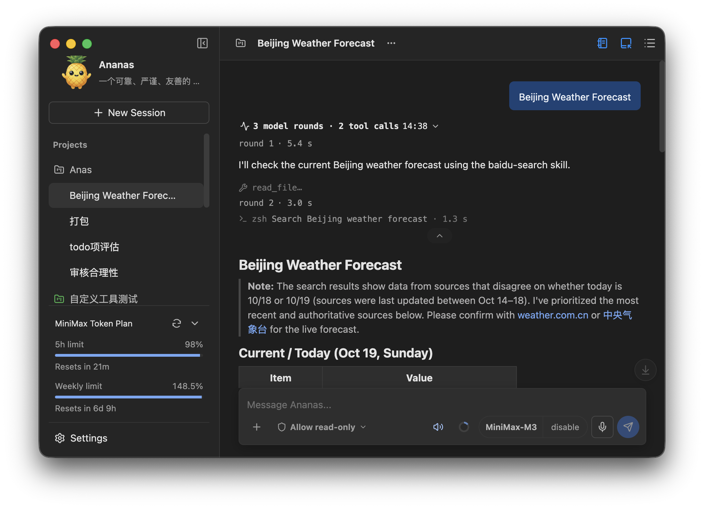

# Anas — Local Desktop AI Agent

[简体中文](README.md) · [English](README.en.md)

**Native execution:** This repository preserves the existing Anas interface, interactions, and configuration while replacing execution, conversation storage, and recovery with native implementations. LangChain, LangGraph, and Deep Agents have been removed. The default data directory is `~/.anas`. Since 5.0, Anas uses fresh native databases and does not migrate conversations, memory, or execution records from the old framework. Copy only compatible settings and extensions; see the [copying instructions](data/help/UPGRADE_TO_5.en.md). Available packages are listed in [GitHub Releases](https://github.com/higale/anas-agent/releases); see the [handoff document](docs/HANDOFF.md) for the current validation scope.

**5.2.0 upgrade notice: the activity display redesign uses a new v3 conversation database. v1/v2 conversations are not migrated, and backups containing old conversation databases cannot be restored. If you still use v1/v2, back up your data and clear those conversations; existing v3 conversations do not need another reset. Settings, project definitions, extensions, and the separate memory database retain their formats.** See the [5.2.0 data impact guide](data/help/UPGRADE_TO_5.en.md#upgrading-to-520-activity-display-redesign).

**Upgrade notice: when upgrading from a pre-4.0 version to 4.x, previous conversations and long-term memory become unavailable. Projects, input history, plugin data, and avatars can be recovered manually. Back up first and read the [4.x upgrade data guide](data/help/UPGRADE_TO_4.en.md).** This notice concerns crossing into 4.x, not data loss on every 4.x update.

Anas is a local desktop AI agent with support for multiple models, projects, tools, skills, and subagents. Each project can choose its working folders, context, and capabilities. Configuration and conversations are stored locally; model requests send the required task content to the selected provider.

[Download](https://github.com/higale/anas-agent/releases) · [GitHub](https://github.com/higale/anas-agent) · [MIT License](LICENSE) · [Contributing](CONTRIBUTING.md)



## Features

- Connect to OpenAI-compatible and Anthropic-compatible model services, with streamed replies and context compression.
- Organize conversations, working folders, and capabilities by project; configure separate models and tools for subagents. Add custom project skill directories, browse skills by source, and open their directories directly.
- Use file, image, network, memory, and command tools, and extend capabilities through MCP, custom tool packages, and Skills.
- Attach text and images and use speech input and output. The built-in file tool converts PDF, DOCX, and PPTX to Markdown offline and exports embedded images without requiring Python.
- View subagents, help, file differences, and plugin pages in the right workspace or separate windows.
- Extend the application with plugin interfaces, tools, and skills; use usage information in model settings to check supported providers' quotas or balances.
- Control tool execution permissions and manage local backups, restores, and startup recovery.

## Download And Get Started

1. Download the appropriate package from [GitHub Releases](https://github.com/higale/anas-agent/releases). On Windows, extract it and run `Anas/Anas.exe`, keeping the complete folder. On macOS, choose the DMG for your Mac's architecture, drag Anas into Applications, and launch it.
2. Add a provider in **Settings > Model**, enter its API URL and key, and configure the models you want to use. No model service credentials are bundled.
3. Create a conversation or project, select a model below the message input, and configure working folders and the permission mode for your task.

### Opening the macOS download

If macOS cannot verify the developer on first launch, choose **Open Anyway** in **System Settings > Privacy & Security**. See the [user guide](data/help/USER_GUIDE.en.md#opening-the-macos-download) for further startup help.

## Plugins

Install plugin ZIPs in **Settings > Plugins**, or drag in a ZIP, plugin folder, or `PLUGIN.json`. Plugins can provide side panels, separate windows, tools, skills, and instructions, with availability configurable by project.

See the [user guide](data/help/USER_GUIDE.en.md#plugins) for plugin installation and management, and the [API documentation](docs/PLUGINS.md) and [examples](data/examples/plugins/README.en.md) for plugin development.

## Usage Information

Enable **Show usage information** on the API Key row in model settings to view provider quotas, balances or spending, with compact/detailed layouts and refresh. Support follows the API URL; unsupported addresses disable and clear the checkbox. Configure Tencent and Bailian query credentials beside it. This is built in, with no Usage Meter plugin or Bailian CLI required. See [supported providers](data/help/USER_GUIDE.en.md#usage-information).

For adding a Bailian RAM user, granting permissions, and resolving common errors, see the [setup guide](data/help/USER_GUIDE.en.md#bailian-ram-authorization-and-query-troubleshooting).

## Local Data

The default data directory is `~/.anas/`. Use `--data-dir <path>` to choose another directory. Project source folders are separate from application data. Anas supports backups and restores; back up project source folders and externally referenced skills separately. See the [user guide](data/help/USER_GUIDE.en.md#local-data-and-backups) for directory locations, contents, and backup coverage.

## Documentation

- User guide: [English](data/help/USER_GUIDE.en.md) · [中文](data/help/USER_GUIDE.zh-CN.md)
- Agent Skills: [English](data/help/AGENT_SKILLS.en.md) · [中文](data/help/AGENT_SKILLS.zh-CN.md)
- [Coding mode and project rules (Chinese)](docs/CODING_MODE.md)
- [Custom tool packages](docs/CUSTOM_TOOLS.md)
- [Plugin development (Chinese)](docs/PLUGINS.md)
- [Plugin examples](data/examples/plugins/README.en.md)
- [Current state storage](docs/CURRENT_STATE_STORAGE.md)
- [Security and approval model](docs/SECURITY_MODEL.md)
- [Dependency patches](docs/DEPENDENCY_PATCHES.md)
- [Coding evaluation](docs/CODING_EVALUATION.md)
- [Development rules](AGENTS.md)

The application's Help menu opens bundled guides in the right workspace pane, with a contents list and saved reading positions.

## Development

Use Node.js 24, npm, and Git, and install dependencies on the target operating system:

```bash
npm ci
npm run dev
```

See the [contribution guide (Chinese)](CONTRIBUTING.md) for environment setup, testing, and local packaging; [AGENTS.md](AGENTS.md) for project conventions; and [source snapshot publishing](docs/SOURCE_PUBLISHING.md) for the release workflow.

## License

Anas uses the [MIT License](LICENSE), copyright © 2026 gale. Third-party components retain their respective licenses; see [Third-party notices](THIRD_PARTY_NOTICES.md).
