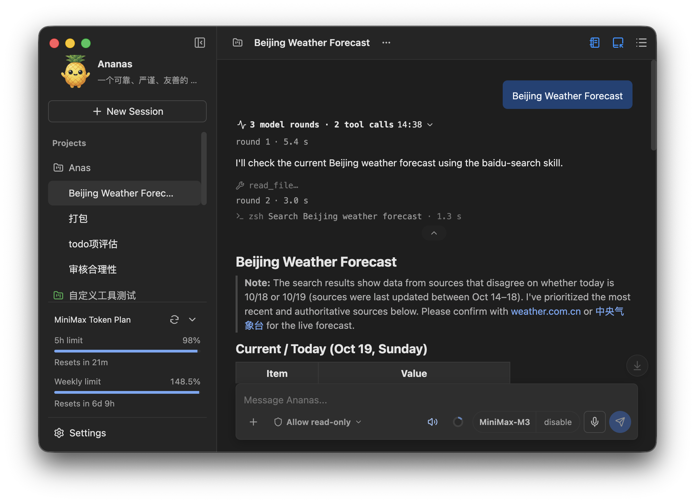

# Anas — Local Desktop AI Agent

[简体中文](README.md) · [English](README.en.md)

**Upgrade notice: when upgrading from a pre-4.0 version to 4.x, previous conversations and long-term memory become unavailable. Projects, input history, plugin data, and avatars can be recovered manually. Back up first and read the [4.x upgrade data guide](data/help/UPGRADE_TO_4.en.md).** This notice concerns crossing into 4.x, not data loss on every 4.x update.

Anas is a local desktop AI agent with support for multiple models, projects, tools, skills, and subagents. Each project can choose its working folders, context, and capabilities. Configuration and conversations are stored locally; model requests send the required task content to the selected provider.

[Download](https://github.com/higale/anas-agent/releases) · [GitHub](https://github.com/higale/anas-agent) · [MIT License](LICENSE) · [Contributing](CONTRIBUTING.md)



## Features

- Connect to OpenAI-compatible and Anthropic-compatible model services, with streamed replies and context compression.
- Organize conversations, working folders, and capabilities by project; configure separate models and tools for subagents.
- Use file, image, network, memory, and command tools, and extend capabilities through MCP, custom tool packages, and Skills.
- Work with text, image, PDF, and DOCX attachments, plus speech input and output.
- View subagents, help, file differences, and plugin pages in the right workspace or separate windows.
- Extend the application with plugin interfaces, tools, and skills; use the built-in Usage Meter to check supported providers' quotas or balances.
- Control tool execution permissions and manage local backups, restores, and startup recovery.

## Download And Get Started

1. Download the appropriate package from [GitHub Releases](https://github.com/higale/anas-agent/releases). On Windows, extract it and run `Anas/Anas.exe`, keeping the complete folder. On macOS, choose the DMG for your Mac's architecture, drag Anas into Applications, and launch it.
2. Add a provider in **Settings > Model**, enter its API URL and key, and configure the models you want to use. No model service credentials are bundled.
3. Create a conversation or project, select a model below the message input, and configure working folders and tool permissions for your task.

### Opening the macOS download

If macOS cannot verify the developer on first launch, choose **Open Anyway** in **System Settings > Privacy & Security**. See the [user guide](data/help/USER_GUIDE.en.md#opening-the-macos-download) for further startup help.

## Plugins

Install plugin ZIPs in **Settings > Plugins**, or drag in a ZIP, plugin folder, or `PLUGIN.json`. Plugins can provide side panels, separate windows, tools, skills, and instructions, with availability configurable by project.

The built-in Usage Meter shows the selected model provider's quota, balance, or spend, with compact/detailed views and a refresh button. Unsupported providers are hidden. See the [user guide](data/help/USER_GUIDE.en.md#plugins) for installation, management, and supported providers; see the [API documentation](docs/PLUGINS.md) and [examples](data/examples/plugins/README.en.md) for plugin development.

## Local Data

The default data directory is `~/.galeAnas/`. Use `--data-dir <path>` to choose another directory. Project source folders are separate from application data. Anas supports backups and restores; back up project source folders and externally referenced skills separately. See the [user guide](data/help/USER_GUIDE.en.md#local-data-and-backups) for directory locations, contents, and backup coverage.

## Documentation

- User guide: [English](data/help/USER_GUIDE.en.md) · [中文](data/help/USER_GUIDE.zh-CN.md)
- Agent Skills: [English](data/help/AGENT_SKILLS.en.md) · [中文](data/help/AGENT_SKILLS.zh-CN.md)
- [Coding mode and project rules (Chinese)](docs/CODING_MODE.md)
- [Custom tool packages](docs/CUSTOM_TOOLS.md)
- [Plugin development (Chinese)](docs/PLUGINS.md)
- [Plugin examples](data/examples/plugins/README.en.md)
- [Current state storage](docs/CURRENT_STATE_STORAGE.md)
- [Security and approval model](docs/SECURITY_MODEL.md)
- [Framework patches](docs/FRAMEWORK_PATCHES.md)
- [Coding evaluation](docs/CODING_EVALUATION.md)
- [Development rules](AGENTS.md)

The application's Help menu opens bundled guides in the right workspace pane, with a contents list and saved reading positions.

## Development

Use Node.js 24, npm, and Git, and install dependencies on the target operating system:

```bash
npm ci
npm run dev
```

See the [contribution guide (Chinese)](CONTRIBUTING.md) for environment setup, testing, and local packaging; [AGENTS.md](AGENTS.md) for project conventions; and [source snapshot publishing](docs/SOURCE_PUBLISHING.md) for the release workflow.

## License

Anas uses the [MIT License](LICENSE), copyright © 2026 gale. Third-party components retain their respective licenses; see [Third-party notices](THIRD_PARTY_NOTICES.md).
