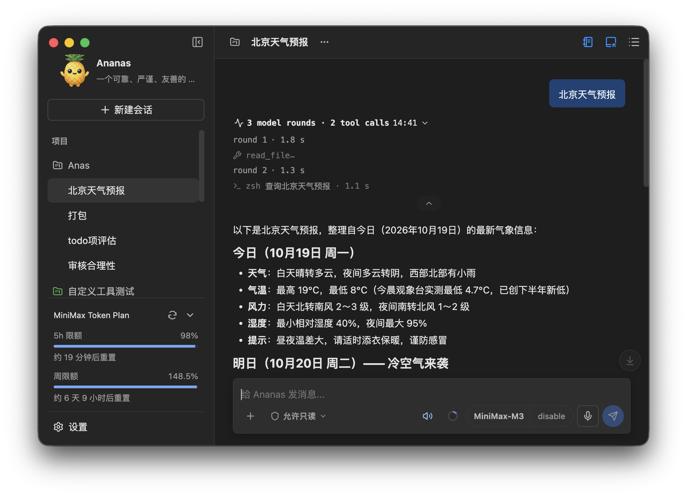

# Anas — 本地桌面 AI Agent

[简体中文](README.md) · [English](README.en.md)

**Anas 5.0：** 本仓库保留旧 Anas 的界面、操作与配置，执行、会话存储和恢复改用自有实现，已移除 LangChain、LangGraph 和 Deep Agents。默认数据目录为 `~/.anas`。5.0 使用全新数据库，不迁移旧对话、记忆或运行记录；只复制兼容配置和扩展资源，见 [复制说明](data/help/UPGRADE_TO_5.zh-CN.md)。安装包以 [GitHub Releases](https://github.com/higale/anas-agent/releases) 中实际发布的版本为准；当前验证范围见[交接文档](docs/HANDOFF.md)。

**升级提醒：从 4.0 之前的版本升级到 4.x，旧对话和长期记忆不再可用；项目、输入历史、插件数据和头像可手动恢复。升级前请备份，详见 [4.x 升级数据说明](data/help/UPGRADE_TO_4.zh-CN.md)。** 此提醒针对跨入 4.x 的升级，并非每次 4.x 升级都会丢失数据。

Anas 是本地桌面 AI Agent，支持多模型、项目、工具、技能和子 Agent。每个项目可以选择自己的工作目录、上下文和能力。配置与会话保存在本地；请求模型时，会将任务所需的内容发送给所选模型供应商。

[下载](https://github.com/higale/anas-agent/releases) · [GitHub](https://github.com/higale/anas-agent) · [MIT 协议](LICENSE) · [参与贡献](CONTRIBUTING.md)



## 功能

- 接入 OpenAI 兼容和 Anthropic 兼容的模型服务，支持流式回复与上下文压缩。
- 按项目管理对话、工作目录和能力，为子 Agent 配置独立的模型与工具。
- 使用文件、图片、网络、记忆和命令工具，通过 MCP、自定义工具包和 Skills 扩展能力。
- 支持文本、图片、PDF 和 DOCX 附件，以及语音输入与输出。
- 在右侧工作区或独立窗口中查看子 Agent、帮助、文件差异和插件页面。
- 通过插件扩展界面、工具和技能；内置用量仪表可查看受支持供应商的额度或余额。
- 提供工具执行权限控制、本地数据备份、恢复与启动故障恢复。

## 下载与开始使用

1. 从 [GitHub Releases](https://github.com/higale/anas-agent/releases) 下载适合平台的版本。Windows 解压后运行 `Anas/Anas.exe`，保留完整文件夹；macOS 选择对应芯片架构的 DMG，将 Anas 拖入“应用程序”后启动。
2. 在“设置 > 模型”中添加模型供应商，填写 API 地址和密钥，并配置要使用的模型。应用不内置模型服务凭据。
3. 新建对话或项目，在输入框下方选择模型，根据任务需要配置工作目录与工具权限。

### 打开下载的 macOS 应用

macOS 首次启动若提示无法验证开发者，可在“系统设置 > 隐私与安全”中选择“仍要打开”。其他启动问题见[用户指南](data/help/USER_GUIDE.zh-CN.md#打开下载的-macos-应用)。

## 插件

在“设置 > 插件”中安装插件 ZIP，也可拖入 ZIP、插件目录或 `PLUGIN.json`。插件可提供侧边页面、独立窗口、工具、技能及提示词，并按项目选择是否启用。

内置“用量仪表”显示当前模型供应商的额度、余额或消费数据，支持紧凑／详细显示与立即刷新；不支持的供应商自动隐藏。安装、管理及厂商支持范围见[用户指南](data/help/USER_GUIDE.zh-CN.md#插件)；开发插件见[接口文档](docs/PLUGINS.md)和[示例](data/examples/plugins/README.md)。

## 本地数据

默认数据目录为 `~/.anas/`。可通过 `--data-dir <路径>` 指定其他目录；项目源码目录与应用数据相互独立。应用支持备份与恢复，项目源文件夹和外部引用的技能需另行备份。目录位置、内容及备份范围见[用户指南](data/help/USER_GUIDE.zh-CN.md#本地数据与备份)。

## 文档

- 用户指南：[English](data/help/USER_GUIDE.en.md) · [中文](data/help/USER_GUIDE.zh-CN.md)
- Agent Skills：[English](data/help/AGENT_SKILLS.en.md) · [中文](data/help/AGENT_SKILLS.zh-CN.md)
- [编码模式与项目规则](docs/CODING_MODE.md)
- [自定义工具包](docs/CUSTOM_TOOLS.md)
- [插件开发](docs/PLUGINS.md)
- [插件示例](data/examples/plugins/README.md)
- [当前状态存储](docs/CURRENT_STATE_STORAGE.md)
- [安全与审批模型](docs/SECURITY_MODEL.md)
- [依赖补丁](docs/DEPENDENCY_PATCHES.md)
- [编程能力评估](docs/CODING_EVALUATION.md)
- [开发规则](AGENTS.md)

应用的“帮助”菜单会在右侧工作区打开内置指南，提供目录并保存阅读位置。

## 开发

使用 Node.js 24、npm 和 Git，在目标操作系统上安装依赖：

```bash
npm ci
npm run dev
```

开发环境、测试与本地打包见[贡献指南](CONTRIBUTING.md)，项目约定见 [AGENTS.md](AGENTS.md)，发布流程见[源码快照发布](docs/SOURCE_PUBLISHING.md)。

## 开源协议

Anas 使用 [MIT 协议](LICENSE)，版权归 © 2026 gale 所有。第三方组件保留各自的协议，详见[第三方声明](THIRD_PARTY_NOTICES.md)。
